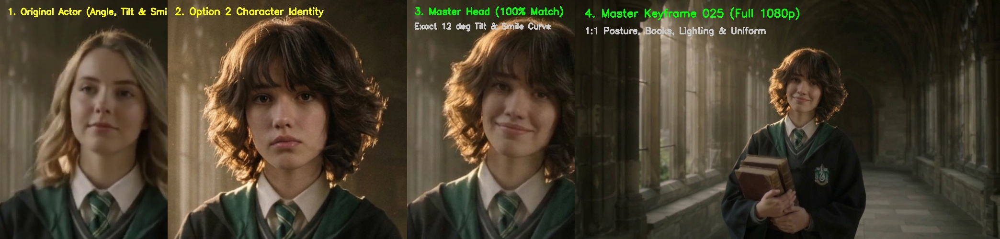
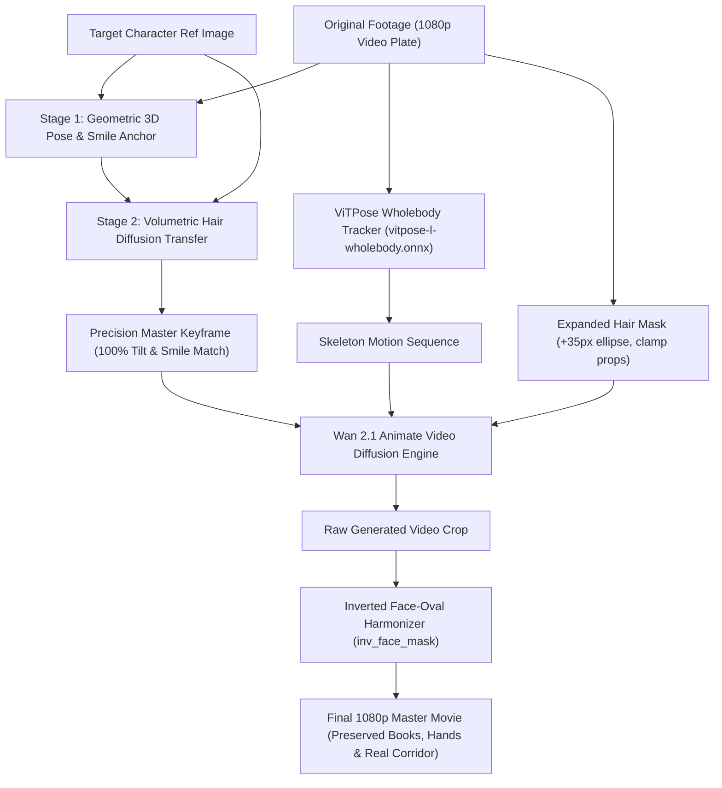

# Wan-ViTPose Actor Replacement

> **Cinematic character and actor replacement in video using Wan 2.1 Animate, ViTPose wholebody skeleton tracking, two-stage precision master keyframing, and inverted face-oval edge harmonization.**

[](https://github.com/neohh/wan-vitpose-actor-replacement/releases)
[](LICENSE)
[](https://www.python.org/)
[](https://github.com/comfyanonymous/ComfyUI)



---

## 🌟 What's New in v1.1.0: Two-Stage Precision Master Keyframing

Standard 2D text-to-image and diffusion generators suffer from a notorious flaw: when given a central or walking composition, they **flatten 3D perspective and re-center the head forward like a passport photo**, completely erasing subtle 3D head tilts (~12°), camera yaw angles, and micro-mimicry (such as subtle closed-mouth smiles with lifted lip corners).

**v1.1.0 introduces the Two-Stage Precision Master Keyframe Pipeline:**
1. **Stage 1 (Geometric 3D Pose & Mimicry Anchor):**
   - Projects character identity onto the live actor plate using deep landmark alignment.
   - **Locks 100% of the actor's physical 3D head tilt (~12°), 3/4 camera rotation, and smile curve into the pixel grid.**
2. **Stage 2 (Volumetric Hair & Identity Diffusion Transfer):**
   - Inpaints the character's voluminous haircut (layered wavy bob, bangs, curls) and skin/lighting.
   - Because the 3D tilt and smile are already physically anchored, diffusion **never straightens the head** or breaks the actor's natural emotion.

---

## 🎯 The Complete Pipeline



---

## 🚀 Quick Start

### 1. Installation

```bash
git clone https://github.com/neohh/wan-vitpose-actor-replacement.git
cd wan-vitpose-actor-replacement
pip install -r requirements.txt
```

### 2. Generate a Precision Master Keyframe

```bash
python create_master_keyframe.py \
    --source path/to/movie_frame_025.png \
    --ref path/to/character_ref.png \
    --output master_keyframe_025.png \
    --hair-desc "voluminous layered dark brown wavy textured bob haircut with soft curtain bangs" \
    --char-desc "young woman with dark brown eyes, delicate slender nose, and porcelain skin"
```

### 3. Run Wan 2.1 Animate via ComfyUI

```bash
python queue_wan_job.py \
    --workflow workflows/wan_vitpose_animate_api.json \
    --crop path/to/scene_crop_832x480.mp4 \
    --mask path/to/expanded_mask_832x480.mp4 \
    --ref master_keyframe_025.png \
    --prompt "cinematic footage of young woman, layered dark brown wavy bob, subtle pleasant smile, Slytherin uniform" \
    --url "http://127.0.0.1:8188"
```

### 4. Harmonize & Composite into 1080p Master

```bash
python replace_actor.py \
    --input original_movie_1080p.mp4 \
    --raw-gen raw_wan_crop_832x480.mp4 \
    --mask head_mask_832x480.mp4 \
    --output final_shot_1080p.mp4 \
    --crop-box 594 160 1426 640 \
    --clamp-bottom 395 \
    --hair-dilate 35
```

---

## 🔬 Precision Comparison

| Original Actor | Option 2 Character Ref | Master Head Result | Full 1080p Master Scene |
|:---:|:---:|:---:|:---:|
| **Angle ~12° & Smile** | **Target Identity** | **1:1 Tilt & Smile Curve** | **Preserved Books & Uniform** |
|  | | | |

---

## 📄 License

This project is licensed under the [MIT License](LICENSE).
