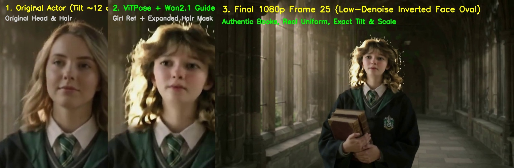
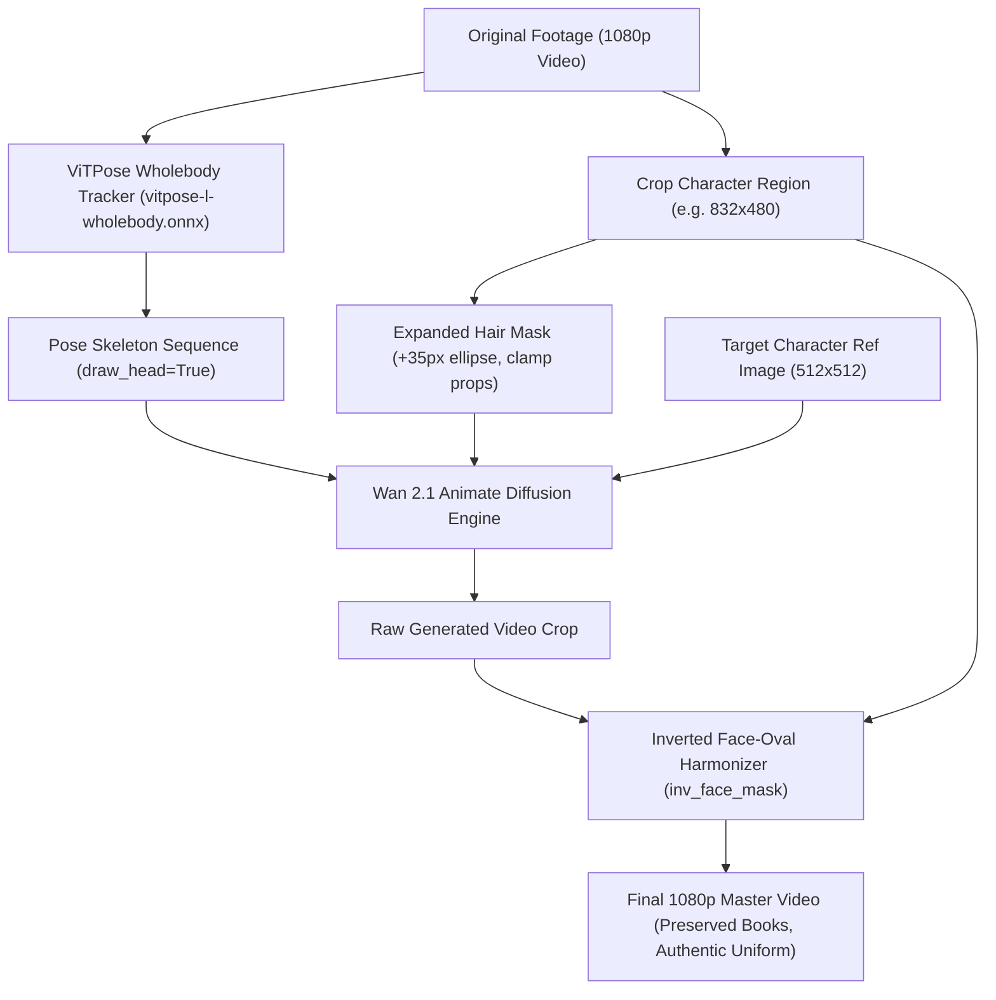
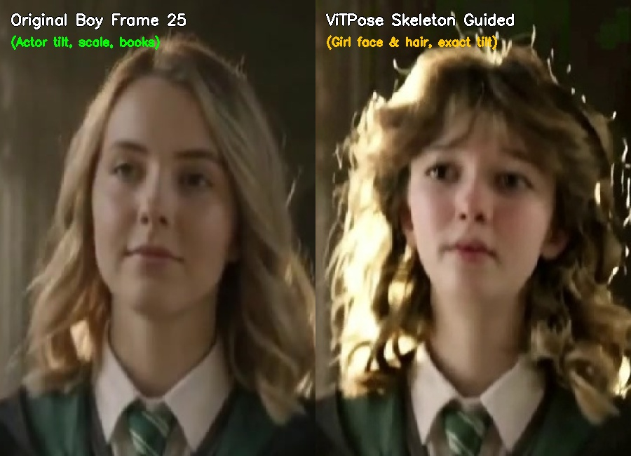
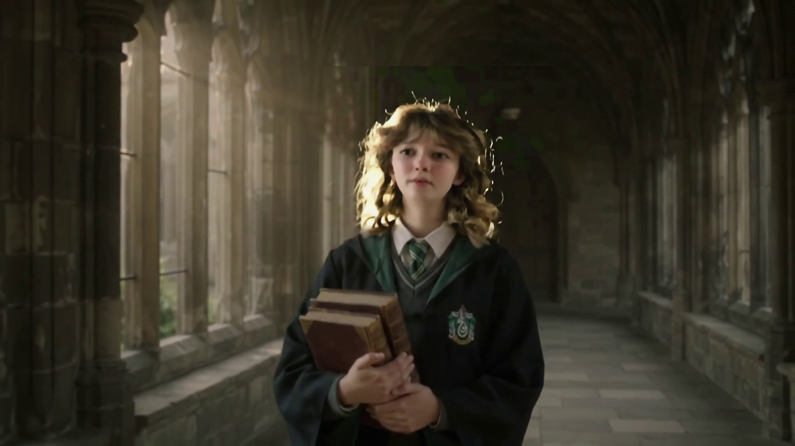

# Wan-ViTPose Actor Replacement

> **Cinematic character and actor replacement in video using Wan 2.1 Animate, ViTPose wholebody skeleton tracking, expanded hair masking, and inverted face-oval edge harmonization.**

[](https://github.com/neohh/wan-vitpose-actor-replacement/releases)
[](LICENSE)
[](https://www.python.org/)
[](https://github.com/comfyanonymous/ComfyUI)



---

## 🎯 The Core Problem & Solution

### ❌ Why standard 2D Image & Face-Swap Approaches Fail:
1. **The "Bobblehead" & Zero-Degree Tilt Problem:** Standard text-to-image generators recompose the head like a passport photo (0° vertical tilt, blank stare, enlarged scale), completely ignoring the original actor's natural head tilt, scale relative to shoulders, and expressive nuance.
2. **Hair Volume Cutoffs:** Traditional face bboxes clip voluminous hairstyles (shaggy bobs, curtain bangs, curls) at the bounding box border.
3. **Erasing Props & Clothes:** Full-body masking overwrites held objects (books, wands, phones, bags) and authentic costumes with hallucinated garments.

### ✅ The ViTPose + Wan 2.1 Solution:
1. **ViTPose Wholebody Skeleton Tracking:** Extracts frame-by-frame 2D joint keypoints (eyes, nose, ears, neck, shoulders, arms, hands) via `vitpose-l-wholebody.onnx` + `yolov10m.onnx`. Feeding this to `WanVideoAnimateEmbeds` forces the diffusion model to strictly follow the original actor's head tilt (~12°), 1.0x scale, and walking posture.
2. **Expanded Hair & Anatomy Masking:** Dynamically dilates the head mask (+35 px ellipse) to provide full volume for curls, bangs, and hair movement, while clamping above hands and props so books and hands stay 100% original.
3. **Inverted Face-Oval Edge Harmonization (`inv_face_mask`):**
   - **Face Interior ($0.0$):** Fully protected from any blur or denoising, keeping 100% razor-sharp AI features.
   - **Outer Hair Perimeter & Collar ($1.0$):** Smoothly blended with the background and collar using edge-modulated bilateral filtering.

---

## 🏗️ Pipeline Architecture



---

## 🚀 Quick Start

### 1. Installation

```bash
git clone https://github.com/neohh/wan-vitpose-actor-replacement.git
cd wan-vitpose-actor-replacement
pip install -r requirements.txt
```

### 2. ComfyUI Prerequisites

Ensure the following custom nodes and models are installed in your ComfyUI instance:
- [ComfyUI-WanVideoWrapper](https://github.com/kijai/ComfyUI-WanVideoWrapper) or Wan 2.1 Animate integration
- `vitpose-l-wholebody.onnx` and `yolov10m.onnx` placed in `ComfyUI/models/onnx/`
- `Wan2.1_Animate` 14B / 1.3B checkpoint

### 3. Generate Character Video via ComfyUI

You can run the included workflow directly via the ComfyUI UI (`workflows/wan_vitpose_animate_ui.json`) or via API:

```bash
python queue_wan_job.py \
    --workflow workflows/wan_vitpose_animate_api.json \
    --crop path/to/scene_crop_832x480.mp4 \
    --mask path/to/expanded_mask_832x480.mp4 \
    --ref path/to/new_character_ref.png \
    --prompt "cinematic footage of young woman, dirty blonde shaggy bob, curtain bangs, natural somber expression" \
    --url "http://127.0.0.1:8188"
```

### 4. Post-Process & Harmonize to 1080p Master

Run the CLI harmonizer on any shot to apply color-matching and the inverted face-oval edge filter:

```bash
python replace_actor.py \
    --input original_movie_1080p.mp4 \
    --raw-gen raw_wan_crop_832x480.mp4 \
    --mask head_mask_832x480.mp4 \
    --output final_shot_1080p.mp4 \
    --crop-box 594 160 1426 640 \
    --clamp-bottom 395 \
    --hair-dilate 35
```

#### CLI Options:
| Flag | Description | Default |
|---|---|---|
| `--input` | Original source video file | *required* |
| `--raw-gen` | Raw crop output from Wan 2.1 Animate | *required* |
| `--mask` | Head/body mask video in crop space | *required* |
| `--output` | Destination 1080p video file | *required* |
| `--crop-box` | Bounding box coordinates `X1 Y1 X2 Y2` in source frame | *required* |
| `--clamp-bottom`| Crop Y coordinate below which mask is zeroed (preserves books/hands) | `None` |
| `--hair-dilate` | Morphological dilation radius for hair volume | `35` |
| `--face-rx` | Horizontal radius of protected face oval | `50` |
| `--face-ry` | Vertical radius of protected face oval | `70` |

---

## 🎬 Multi-Shot Timeline Stitching

To assemble a finished cinematic scene containing multiple shots (e.g. replaced character shots combined with untouched live-action camera shots):

```python
from core.timeline import assemble_timeline

shots = [
    {"video_path": "shot1_replaced_1080p.mp4", "start_frame": 0, "end_frame": 45},
    {"video_path": "original_footage_1080p.mp4", "start_frame": 46, "end_frame": 81}, # 100% untouched
    {"video_path": "shot3_replaced_1080p.mp4", "start_frame": 0, "end_frame": 34},
]

assemble_timeline(shots, output_path="master_film_1080p.mp4", fps=24.0)
```

---

## 🔬 Comparison & Inspection

| Original Footage | ViTPose Wan 2.1 | Final Harmonized Master |
|:---:|:---:|:---:|
|  | *(Exact tilt ~12°, scale 1.0x)* |  |

---

## 📄 License

This project is licensed under the [MIT License](LICENSE).
